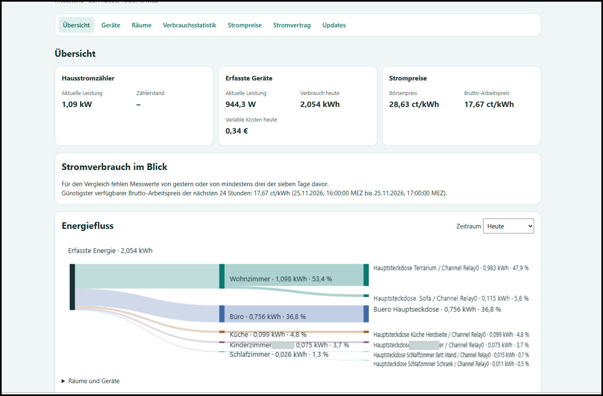
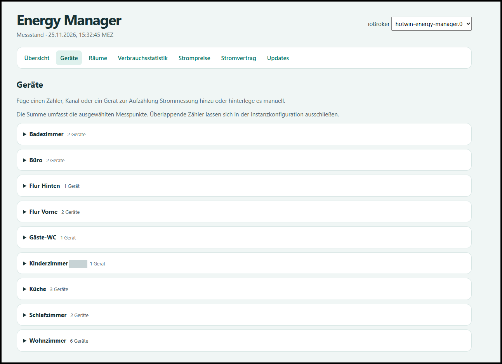
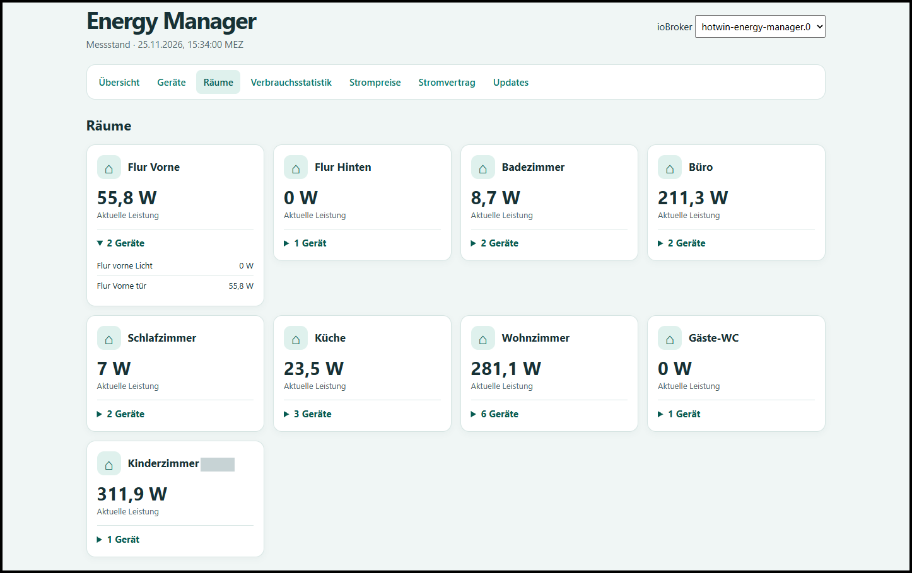
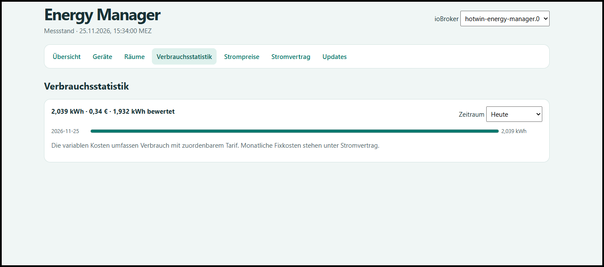
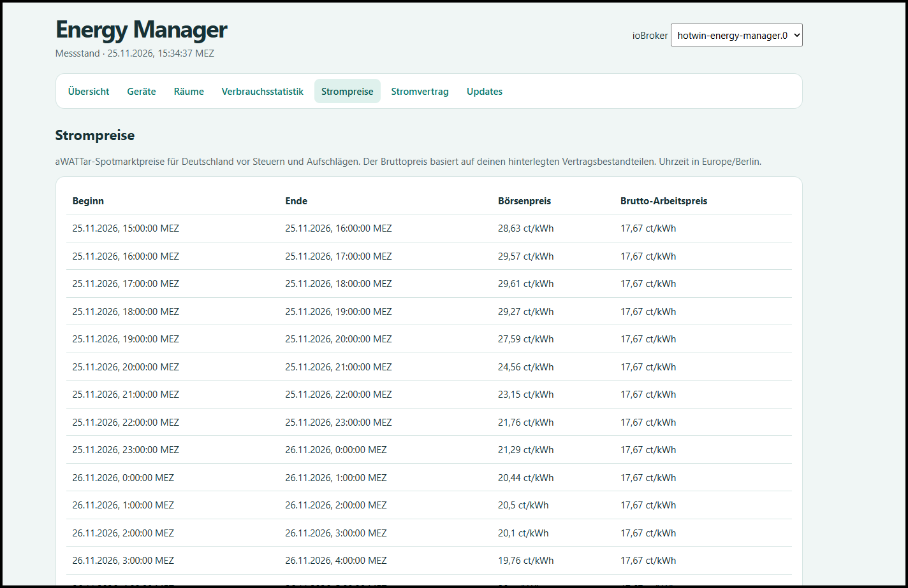
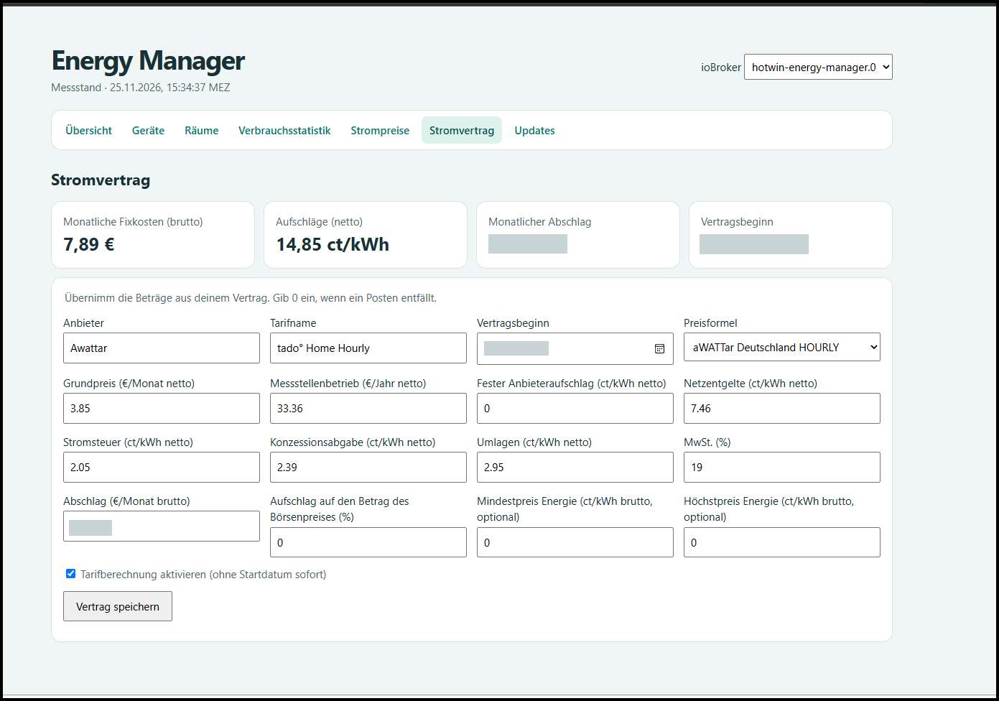
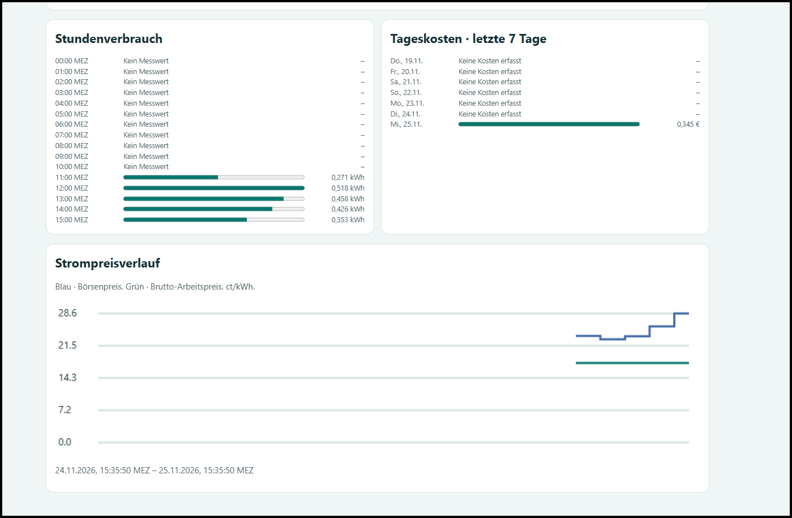

# ioBroker Energy Manager

[](https://github.com/hotwin/ioBroker.hotwin-energy-manager)
[](https://www.npmjs.com/package/iobroker.hotwin-energy-manager)
[](https://www.npmjs.com/package/iobroker.hotwin-energy-manager)
[](https://github.com/hotwin/ioBroker.hotwin-energy-manager/actions/workflows/test-and-release.yml)
[](https://github.com/hotwin/ioBroker.hotwin-energy-manager/blob/main/LICENSE)
[](https://github.com/hotwin/ioBroker.hotwin-energy-manager/issues)

**Verantwortlich: Böttcher Services**

**Aktuelle GitHub-Beta: 0.3.0-beta.12 (25.11.2026)**

Der Energy Manager erfasst Stromverbrauch, Leistung und variable Stromkosten lokal in ioBroker. Er verbindet Messdaten verschiedener Hersteller mit Raumübersichten und dynamischen Börsenpreisen von [aWATTar](https://www.awattar.de/).

[English](README.md) · [Dokumentation](doc/de/README.md) · [Änderungsprotokoll](#changelog--versionsverlauf) · [npm](https://www.npmjs.com/package/iobroker.hotwin-energy-manager)

## Funktionen

- Herstellerübergreifende Geräteerkennung über Strommessung, manuelle Zuordnung und optionale Shelly-Erkennung.
- Live-Leistung, Verbrauch, Raumkarten mit aufklappbaren Geräten und bearbeitbare Gerätenamen.
- Energieflussdiagramm, Stundenverbrauch, Tageskosten und Strompreisverlauf.
- Statistiken für sieben Tage, Monat, Quartal und Jahr.
- Bearbeitbare Vertragsdaten, Brutto-Arbeitspreis, Mehrwertsteuer, aWATTar HOURLY-Aufschlag und optionale Preisgrenzen.
- Responsives deutsch- und englischsprachiges Dashboard im Admin und optional über den Web-Adapter.

## Screenshots – 0.3.0-beta.12

Aufnahmen einer laufenden Beta-12-Instanz. Persönliche Angaben wurden teilweise anonymisiert; die angezeigten Tarifwerte sind noch Gegenstand der Fehlerprüfung (#23).

### Übersicht und Energieverteilung nach Räumen und Geräten



### Geräte nach Räumen gruppiert



### Raumkarten mit aktueller Leistung



### Verbrauchsstatistik



### Strompreisintervalle



### Stromvertragskonfiguration



### Stundenverbrauch, Tageskosten und Strompreisverlauf



## Installation

Voraussetzungen: Node.js ab 22, Admin ab 7.6.20, js-controller ab 6.0.11 sowie vorhandene Messdatenpunkte.

[Beta 12 herunterladen (.tgz)](https://raw.githubusercontent.com/hotwin/ioBroker.hotwin-energy-manager/packages/0.3.0-beta.12/iobroker.hotwin-energy-manager-0.3.0-beta.12.tgz). Füge die Download-URL im ioBroker Admin unter **Adapter → Aus eigener URL installieren** ein.

Die bisherige npm-Beta 8 lässt sich weiterhin installieren:

```bash
iobroker add hotwin-energy-manager@0.3.0-beta.8
```

Der Adapter ist noch nicht im offiziellen ioBroker Latest- oder Stable-Repository.

## Einrichtung

Wähle unter **Hausstromzähler** in der Instanzkonfiguration die Datenpunkte für Zählerstand und aktuelle Leistung. Die ausgewählten Werte erscheinen in der Übersicht. Unter **Geräte** lassen sich die Geräte nach Raum aufklappen.

Die Adapterkennung lautet jetzt `hotwin-energy-manager`. ioBroker legt dafür eine neue Instanz an. Bisherige Einstellungen und Verbrauchsdaten bleiben bei der alten Instanz. Seit Beta 9 gibt es eine [optionale Übernahme](doc/de/README.md#daten-aus-einer-alten-instanz-übernehmen).

1. Lege im ioBroker Admin eine Funktionsaufzählung namens **Strommessung** oder **Energy measurement** an.
2. Füge die numerischen Messdatenpunkte, deren Kanal oder das Gerät hinzu. **W** oder **kW** liefern die Live-Leistung, ein fortlaufender Zähler in **Wh** oder **kWh** liefert den Verbrauch. Lege Leistung und Energie nach Möglichkeit in denselben Kanal.
3. Weise Geräte über die ioBroker-Raumaufzählungen zu. Manuell hinterlegte Raumnamen haben Vorrang. Die automatische Shelly-Erkennung lässt sich in der Instanzkonfiguration abschalten.
4. Aktiviere die Instanz und öffne Energy Manager im Admin-Menü. Optional erreichst du das Dashboard über den Web-Adapter unter `/hotwin-energy-manager/index.html` mit integriertem Socket und aktivierten WebSockets.
5. Hinterlege die Nettobestandteile deines Vertrags und die Mehrwertsteuer in der Instanzkonfiguration. Aktiviere den berechneten Bruttotarif, sobald du die Bestandteile geprüft hast.

Der Adapter speichert Verbrauch anhand fortlaufender Zählerstände. Rücksetzungen, längere Messlücken und Intervalle über Mitternacht setzen den Ausgangswert neu. Die Aufzeichnung beginnt mit der Installation. Geräte mit reiner Leistungsmessung tragen zur Live-Leistung bei. Bei einem Preisintervall- oder Tarifwechsel zwischen Messungen wird der Verbrauch erfasst und bleibt ohne Kostenbewertung. Die Statistik zeigt erfasste variable Kosten und bewertete Kilowattstunden. Monatliche Fixkosten und Abschläge stehen unter Stromvertrag. Vergleiche den verwendeten aWATTar-Spotmarktpreis für Deutschland mit dem Preisindex deines Anbieters.

Schließe überlappende Haupt- oder Unterzähler in den manuellen Energiequellen aus, damit die Summen sie nur einmal enthalten. Geräte mit uneindeutiger Datenpunktstruktur lassen sich ebenfalls manuell zuordnen. Der Adapter behält bis zu 400 Tageswerte in ioBroker.


## Weiterentwicklung

Die automatischen Tests und der npm-Upload der Beta 8 waren erfolgreich. Der Adapter soll langfristig gepflegt und anhand von Rückmeldungen weiterentwickelt werden.

- [Datenmigration](https://github.com/hotwin/ioBroker.hotwin-energy-manager/issues/11): optional verfügbar. Alte Instanz bitte behalten und Daten sichern.
- [Aufnahme in ioBroker Latest](https://github.com/hotwin/ioBroker.hotwin-energy-manager/issues/10): in Vorbereitung.
- Der Hauptbranch enthält den Quellcode der GitHub-Beta.

Fehler und Vorschläge: [GitHub Issues](https://github.com/hotwin/ioBroker.hotwin-energy-manager/issues) oder [ioBroker-Forum](https://forum.iobroker.net/topic/85923/test-adapter-energy-manager/4).

## Changelog / Versionsverlauf

### 0.3.0-beta.12 – 2026-11-25

- DE: Geräte werden nach Räumen in aufklappbaren Gruppen angezeigt. Der Schnellzugriff verlinkt das Web-Dashboard des Energy Managers.
- EN: Devices appear in expandable groups by room. Quick access links to the Energy Manager web dashboard.

### 0.3.0-beta.11 – 2026-11-25

- DE: Die Übersicht gruppiert Hausstromzähler, erfasste Geräte und Strompreise in drei Bereichen. Der Hinweis zu überlappenden Messpunkten steht unter Geräte.
- EN: The overview groups the main electricity meter, monitored devices, and electricity prices into three panels. The note about overlapping measurement points moved to Devices.

### 0.3.0-beta.10 – 2026-11-25

- DE: Datenpunkte für Zählerstand und aktuelle Leistung des Hausstromzählers lassen sich einzeln in der Instanzkonfiguration auswählen und erscheinen in der Übersicht.
- EN: Select the house meter's reading and current power independently in the instance settings to display them in the overview.

### 0.3.0-beta.9 – 2026-11-25

- DE: Lokale Verbrauchsauswertung mit Vergleich zum Durchschnitt erfasster Vortage und günstigstem verfügbaren Tarifintervall der nächsten 24 Stunden.
- Optionale Übernahme von Einstellungen, Tarif, Gerätealiasen und Verbrauchsverlauf mit Probelauf und Sicherung.

### 0.3.0-beta.8 – 2026-11-24

- DE: Adapterkennung auf `hotwin-energy-manager` geändert, um den npm-Namenskonflikt zu lösen.
- EN: Rename the adapter ID to `hotwin-energy-manager` to resolve the npm package name conflict.
- DE: Offizielles ioBroker-Release-Script für Versionsabgleich, Changelog und Git-Tags eingerichtet.
- EN: Configure the official ioBroker release script for version synchronization, changelog entries, and Git tags.

### 0.3.0-beta.7 – 2026-11-24

- DE: Gerätenamen über ein dezentes Stiftsymbol und einen klareren Dialog bearbeiten. „Aktuelle Leistung“ zeigt nur Messwert und Einheit. Details zum Messpunkt stehen beim Gerätenamen.
- EN: Edit device names with a pencil button and a clearer dialog. Current power displays only the reading and unit. Power source details appear under the device name.

### 0.3.0-beta.6 – 2026-11-24

- DE: Die Raumübersicht zeigt aktuelle Leistung und Geräteanzahl in kompakten Karten. Die Geräteliste mit Einzelwerten lässt sich je Raum aufklappen.
- EN: Compact room cards show current power and device count. Expand each card to see individual device readings.

### 0.3.0-beta.5 – 2026-11-24

- DE: Energiefluss von der erfassten Gesamtenergie über Räume zu Geräten sowie Verlauf für Stundenverbrauch, Tageskosten und Strompreise auf der Startseite. Die neuen Messreihen beginnen mit der Aufzeichnung nach dem Update.
- EN: Energy flow from recorded total to rooms and devices, with hourly usage, daily costs and electricity price history on the overview. New measurement series start recording after the update.

### 0.3.0-beta.4 – 2026-11-24

- DE: Gerätenamen im Admin speichern. Die Geräteliste zeigt Leistungsdatenpunkte und Einheiten an und bevorzugt aktuelle Messwerte.
- EN: Store device aliases in Admin. The device list shows power state IDs and units and prefers live measurements.

### 0.3.0-beta.3 – 2026-11-24

#### Deutsch

- Vertragsdaten im ioBroker Admin bearbeiten und dauerhaft in der Instanz speichern.
- Brutto-Arbeitspreis anhand der gewählten Formel berechnen. aWATTar HOURLY unterstützt den prozentualen Aufschlag auf den Betrag des Börsenpreises und optionale Bruttopreisgrenzen für die Energie.
- Fehlende Vertragsbeträge, einen späteren Vertragsstart und fehlende aktuelle Börsenpreise im Dashboard anzeigen.

#### English

- Edit contract details in ioBroker Admin and persist them in the instance configuration.
- Calculate gross rates with the selected formula. aWATTar HOURLY supports a percentage surcharge on the absolute spot price and optional gross energy price limits.
- Explain missing contract inputs, future start dates and unavailable market prices in the dashboard.

### 0.3.0-beta.2 – 2026-11-24

#### Deutsch

- Anklickbare Kacheln für Leistung, Verbrauch, Kosten, Börsenpreis und Brutto-Arbeitspreis.
- Die Preisübersicht zeigt Börsenpreis und den berechneten Brutto-Arbeitspreis je verfügbarem Preisintervall.

#### English

- Clickable tiles for power, consumption, costs, market price and gross contract rate.
- The price view displays the market price and calculated gross contract rate for each available interval.

### 0.3.0-beta.1 – 2026-11-24

#### Deutsch

- Responsives Dashboard im ioBroker Admin mit Übersicht, Geräten, Räumen, Verbrauchsstatistik, Preisen, Vertrag und Updates.
- Geräteerkennung über die Aufzählung Strommessung, mit manueller Zuordnung und optionaler Shelly-Erkennung.
- Neues PNG-Icon sowie deutsche und englische Texte im Dashboard und in der Konfiguration.
- Auswertungen für sieben Tage, Monat, Quartal und Jahr. Tarifgrenzen und Fixkosten werden separat behandelt.
- ESLint, ioBroker-Paketprüfung sowie Integrations- und Compact-Mode-Tests in der abgesicherten GitHub-Workflow-Matrix.

#### English

- Responsive ioBroker Admin dashboard covering overview, devices, rooms, statistics, prices, contract and updates.
- Energy measurement enum discovery across vendors, with manual mappings and optional Shelly discovery.
- New PNG icon and English and German dashboard and configuration text.
- Seven-day, monthly, quarterly and annual statistics. Tariff boundaries and fixed charges are handled separately.
- ESLint, ioBroker package validation, and integration and Compact Mode tests in the pinned GitHub workflow matrix.

### 0.2.1 – 2026-11-24
- DE: WebSocket-Transport ausdrücklich gewählt, um HTTP-Polling bei erzwungenen WebSockets zu vermeiden. Live-Anzeige im Praxistest bestätigt.
- EN: Explicit WebSocket transport avoids HTTP polling when WebSockets are forced. Live display confirmed in practical test.

### 0.2.0 – 2026-11-24
- DE: Experimentelle Socket.IO-Live-Anbindung ersetzt REST-Abfrage. Weboberfläche erreichbar; Verbindung meldet `xhr poll error` bei erzwungenen WebSockets.
- EN: Experimental Socket.IO live connection replaces REST polling. Dashboard loads; connection reports `xhr poll error` with forced WebSockets.

### 0.1.0 – 2026-11-24
- DE: Erste Alpha-Version mit Shelly-Erkennung, manuellen Energiequellen, Raumzuordnung, aWATTar-Preisen und Web-Dashboard. Installation und Leistungsberechnung praktisch bestätigt. REST-Endpunkt liefert 404.
- EN: Initial alpha with Shelly discovery, manual energy sources, room assignment, aWATTar prices and web dashboard. Installation and power calculation confirmed in a practical test. REST endpoint returns 404.


## Lizenz

MIT – Copyright (c) 2026 hotwin. Siehe [LICENSE](LICENSE).
