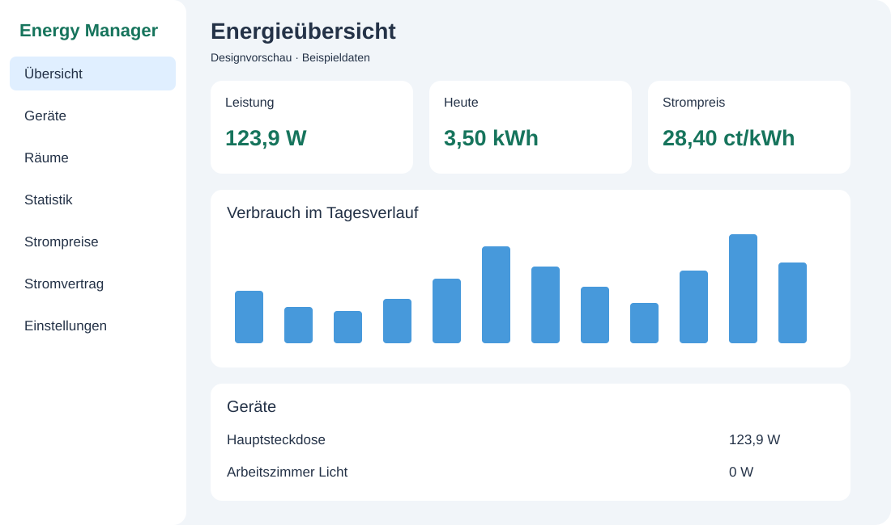

# ioBroker Energy Manager

[Deutsch](README.md) | **English**

Local energy management for ioBroker with Shelly and dynamic electricity tariffs.

**Status: 0.1.0 – under development. Not yet ready for installation or tested on ioBroker.**

## Features

Currently present in the source code:
- Automatic discovery of Shelly power data points and reading energy meters.
- Retrieval of German aWATTar wholesale electricity prices.
- Configurable tariff surcharges and VAT.
- JSON snapshot and dashboard prototype with manual JSON import.

## Roadmap

- [ ] Automatic live dashboard connection.
- [ ] Historical consumption and cost calculations using time-dependent prices.
- [ ] Configurable energy sources, names, rooms and data point selection.
- [ ] Zigbee2MQTT and other manufacturers via arbitrary ioBroker data points.
- [ ] Admin integration and standalone responsive web interface.
- [ ] Electricity contracts, base charges, monthly payments and forecasts.
- [ ] Optional AI analysis and reports.
- [ ] Installation and integration tests.

## Requirements

Planned: ioBroker with the Shelly adapter, Node.js 18 or newer, and the Web and History adapters for their respective integrations.

## Installation

No approved installation version yet. Do not install on a production system. Verified instructions will follow with the test release.

## Tariffs and measurement accuracy

Wholesale prices do not represent the full retail electricity price. Contract components must be verified. The sum of monitored devices does not necessarily represent total household consumption. Overlapping meters may cause double counting.

## Privacy

Measurements are processed locally; retrieving prices requires internet access. The adapter is designed to access energy sources in read-only mode.

## Documentation

- [Development status (German)](docs/STATUS.md)
- [Energy sources (German)](docs/ENERGY-SOURCES.md)
