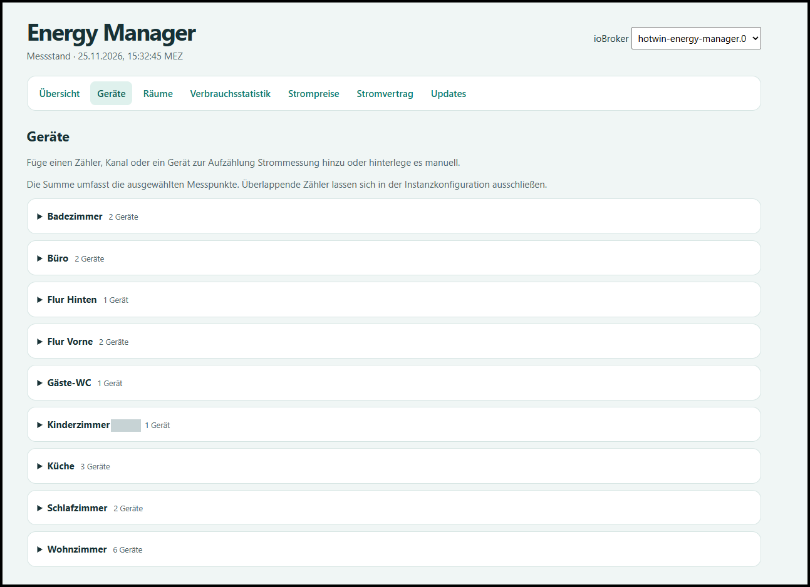
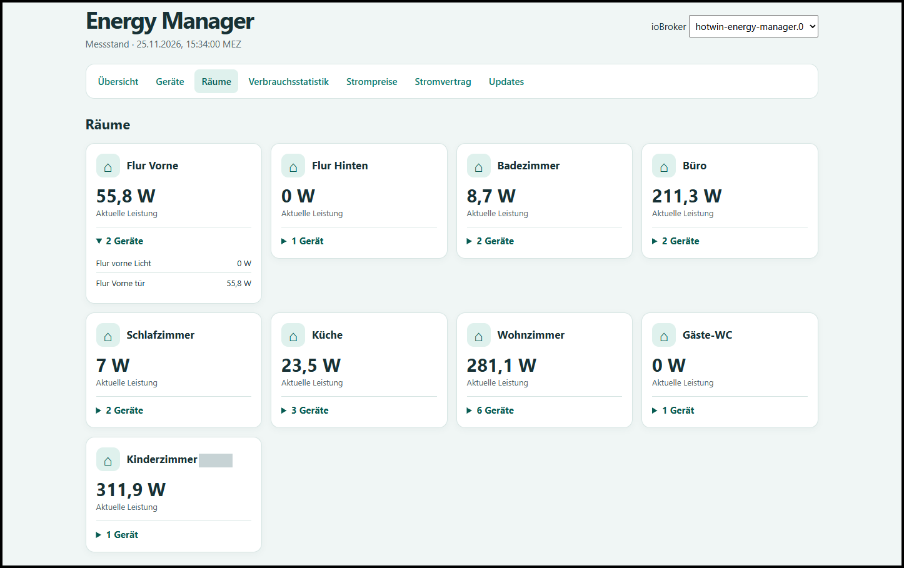
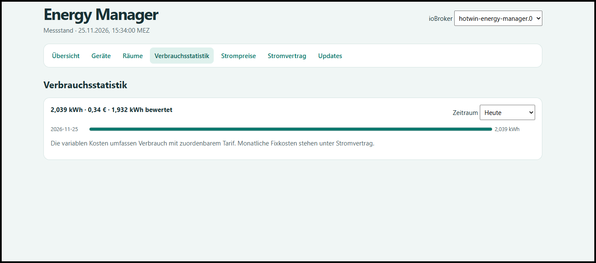
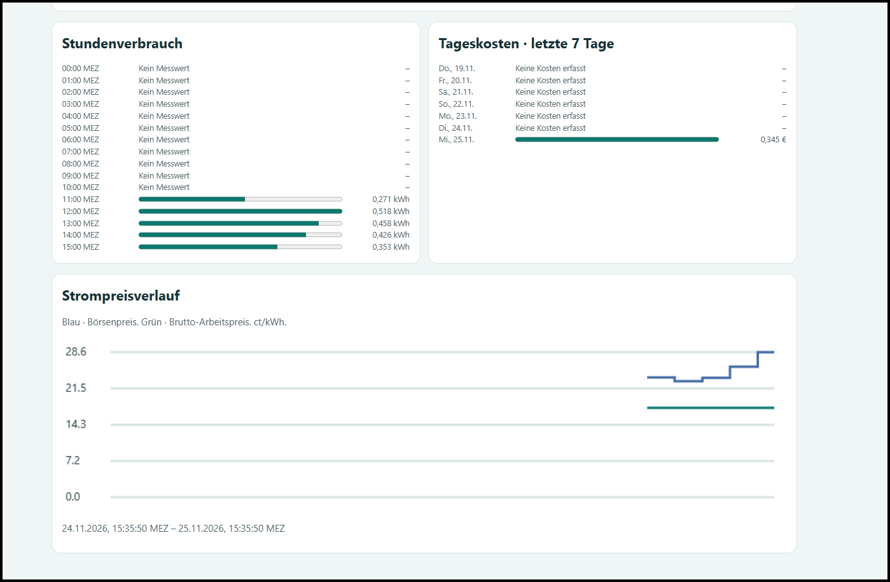

# ioBroker Energy Manager

**Responsible: Böttcher Services** · [hotwin@gmx.net](mailto:hotwin@gmx.net)

**Current published beta: 0.3.0-beta.8**

Local energy monitoring and electricity cost analysis for ioBroker, with a responsive dashboard, room and device statistics, and German day-ahead market prices from [aWATTar](https://www.awattar.de/).

[Deutsch](doc/de/README.md) · [English setup guide](doc/en/README.md) · [Development](DEVELOPMENT.md) · [Changelog](#changelog)

## Features

- Vendor-independent discovery via the Strommessung / Energy measurement function enum, manual mappings and optional Shelly discovery.
- Live power in W/kW and cumulative energy in Wh/kWh; room assignments from ioBroker enums.
- Responsive Admin dashboard with overview, devices, expandable room cards, statistics, prices and contract settings.
- Editable device aliases, energy flow from recorded total to rooms and devices, hourly consumption, daily costs and price history.
- Seven-day, monthly, quarterly and annual statistics; up to 400 daily records.
- Editable tariff components, VAT, aWATTar HOURLY percentage surcharge and optional gross energy price limits. Fixed charges and advance payments are shown separately.
- German and English interface; optional Web adapter dashboard.

## Screenshots – 0.3.0-beta.12

Screenshots from a running beta.12 instance. Personal details have been partially anonymized; the displayed tariff values are still under investigation (#23).

### Overview and room/device energy distribution

### Devices grouped by room

### Room cards and live power

### Consumption statistics

### Electricity price intervals

### Contract configuration

### Hourly consumption, daily costs and price history

## Installation

Requires Node.js 22+, ioBroker Admin 7.6.20+ and js-controller 6.0.11+. Measurement states must be supplied by installed device adapters.

Install Energy Manager from **Adapters** in ioBroker Admin once it is available in your configured repository. The adapter is awaiting admission to the official ioBroker Latest and Stable repositories.

**Migration warning:** the previous adapter ID was energy-manager. The new ID is hotwin-energy-manager. Existing settings and history remain in the old namespace; beta.9 and later support an [opt-in import](doc/en/README.md#import-from-a-legacy-instance). Keep the old instance and back up its data.

## Setup and data accuracy

Select the main meter’s power and cumulative reading states in the instance settings to show them in the overview. Expand rooms under **Devices** to see individual readings.

Add measurement states, channels or devices to the Strommessung or Energy measurement function enum. Assign rooms, configure manual sources and exclusions as needed, and enter verified contract components. Open Energy Manager in the Admin sidebar. The optional Web dashboard is available at /hotwin-energy-manager/index.html with integrated socket and WebSockets.

Consumption is calculated from cumulative meter differences after recording begins. Resets, long gaps and midnight boundaries reset the baseline. Intervals spanning a price or tariff change are recorded without cost valuation. Exclude overlapping meters to avoid double counting. Market prices may differ from your supplier's index.

## Support and development

Report issues in [GitHub Issues](https://github.com/hotwin/ioBroker.hotwin-energy-manager/issues) or the [ioBroker forum](https://forum.iobroker.net/topic/85923/test-adapter-energy-manager/4). See [DEVELOPMENT.md](DEVELOPMENT.md) for development and release procedures.

## Changelog

### 0.3.0-beta.12 – 2026-11-25

- Devices appear in expandable groups by room. Quick access links to the Energy Manager web dashboard.

### 0.3.0-beta.11 – 2026-11-25

- The overview groups the main electricity meter, monitored devices, and electricity prices into three panels. The note about overlapping measurement points moved to Devices.

### 0.3.0-beta.10 – 2026-11-25

- Select the house meter's reading and current power independently in the instance settings to display them in the overview.

### 0.3.0-beta.9 – 2026-11-25

- Local consumption insights compare yesterday with recorded prior days and highlight the cheapest available tariff interval in the next 24 hours.
- Opt-in import of settings, tariff, device aliases and consumption history with preview and backup.

### 0.3.0-beta.8 – 2026-11-24

- Rename the adapter ID to `hotwin-energy-manager` to resolve the npm package name conflict.
- Configure the official ioBroker release script for version synchronization, changelog entries, and Git tags.

### 0.3.0-beta.7 – 2026-11-24

- Edit device names with a pencil button and a clearer dialog. Current power displays only the reading and unit. Power source details appear under the device name.

### 0.3.0-beta.6 – 2026-11-24

- Compact room cards show current power and device count. Expand each card to see individual device readings.

### 0.3.0-beta.5 – 2026-11-24

- Energy flow from recorded total to rooms and devices, with hourly usage, daily costs and electricity price history on the overview. New measurement series start recording after the update.

### 0.3.0-beta.4 – 2026-11-24

- Store device aliases in Admin. The device list shows power state IDs and units and prefers live measurements.

### 0.3.0-beta.3 – 2026-11-24

- Edit contract details in ioBroker Admin and persist them in the instance configuration.
- Calculate gross rates with the selected formula. aWATTar HOURLY supports a percentage surcharge on the absolute spot price and optional gross energy price limits.
- Explain missing contract inputs, future start dates and unavailable market prices in the dashboard.

### 0.3.0-beta.2 – 2026-11-24

- Clickable tiles for power, consumption, costs, market price and gross contract rate.
- The price view displays the market price and calculated gross contract rate for each available interval.

### 0.3.0-beta.1 – 2026-11-24

- Responsive ioBroker Admin dashboard covering overview, devices, rooms, statistics, prices, contract and updates.
- Energy measurement enum discovery across vendors, with manual mappings and optional Shelly discovery.
- New PNG icon and English and German dashboard and configuration text.
- Seven-day, monthly, quarterly and annual statistics. Tariff boundaries and fixed charges are handled separately.
- ESLint, ioBroker package validation, and integration and Compact Mode tests in the pinned GitHub workflow matrix.

### 0.2.1 – 2026-11-24
- Explicit WebSocket transport avoids HTTP polling when WebSockets are forced. Live display confirmed in practical test.

### 0.2.0 – 2026-11-24
- Experimental Socket.IO live connection replaces REST polling. Dashboard loads; connection reports `xhr poll error` with forced WebSockets.

### 0.1.0 – 2026-11-24
- Initial alpha with Shelly discovery, manual energy sources, room assignment, aWATTar prices and web dashboard. Installation and power calculation confirmed in a practical test. REST endpoint returns 404.

[Older release notes](CHANGELOG_OLD.md)

## License

Copyright (c) 2026 hotwin <hotwin@gmx.net>. MIT. See [LICENSE](LICENSE).
