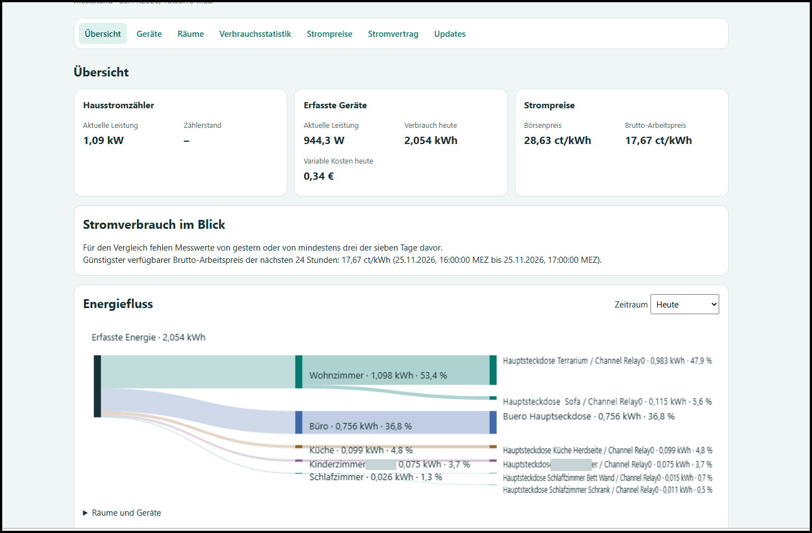
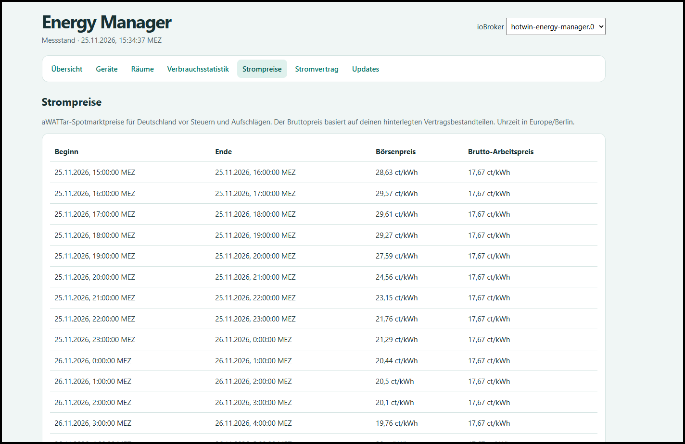
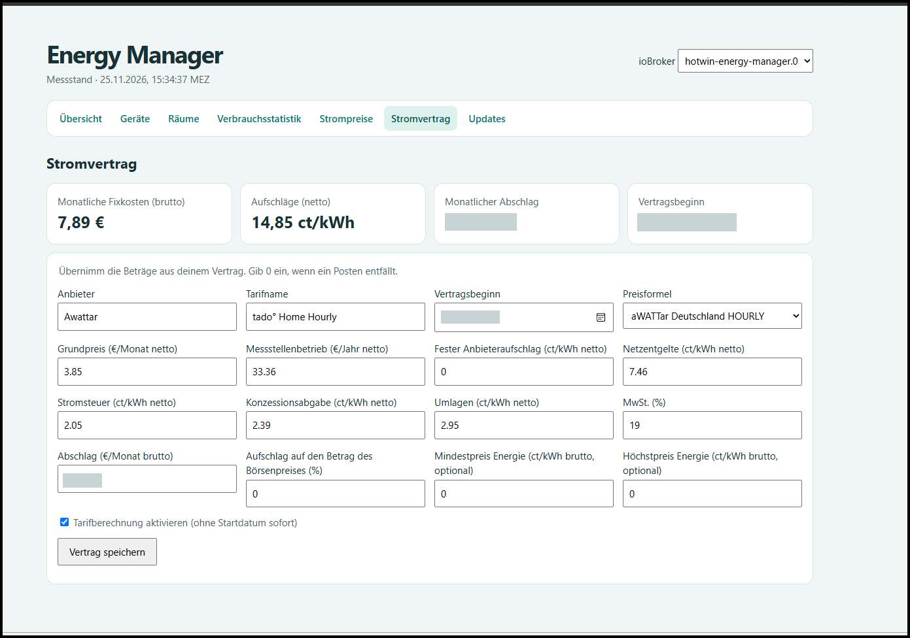

# ioBroker Energy Manager

[](https://github.com/hotwin/ioBroker.hotwin-energy-manager)
[](https://www.npmjs.com/package/iobroker.hotwin-energy-manager)
[](https://www.npmjs.com/package/iobroker.hotwin-energy-manager)
[](https://github.com/hotwin/ioBroker.hotwin-energy-manager/actions/workflows/test-and-release.yml)
[](https://github.com/hotwin/ioBroker.hotwin-energy-manager/blob/main/LICENSE)
[](https://github.com/hotwin/ioBroker.hotwin-energy-manager/issues)

**Responsible: [Böttcher Services](http://boettcher-services.duckdns.org/)**

**Current GitHub beta: 0.3.0-beta.12 (25 November 2026)**

Local energy monitoring and electricity cost analysis for ioBroker, with a responsive dashboard, room and device statistics, and German day-ahead market prices from [aWATTar](https://www.awattar.de/).

[Deutsch](README.de.md) · [English setup guide](doc/en/README.md) · [Development](DEVELOPMENT.md) · [Changelog](CHANGELOG.md)

## Features

- Vendor-independent discovery via the Strommessung / Energy measurement function enum, manual mappings and optional Shelly discovery.
- Live power in W/kW and cumulative energy in Wh/kWh; room assignments from ioBroker enums.
- Responsive Admin dashboard with overview, devices, expandable room cards, statistics, prices and contract settings.
- Editable device aliases, energy flow from recorded total to rooms and devices, hourly consumption, daily costs and price history.
- Seven-day, monthly, quarterly and annual statistics; up to 400 daily records.
- Editable tariff components, VAT, aWATTar HOURLY percentage surcharge and optional gross energy price limits. Fixed charges and advance payments are shown separately.
- German and English interface; optional Web adapter dashboard.

## Screenshots – 0.3.0-beta.12

Screenshots from a running beta.12 instance. Personal details have been partially anonymized; the displayed tariff values are still under investigation (#23).

### Overview and room/device energy distribution



### Devices grouped by room


### Room cards and live power


### Consumption statistics


### Electricity price intervals



### Contract configuration



### Hourly consumption, daily costs and price history


## Installation

Requires Node.js 22+, ioBroker Admin 7.6.20+ and js-controller 6.0.11+. Measurement states must be supplied by installed device adapters.

[Download beta.12 (.tgz)](https://raw.githubusercontent.com/hotwin/ioBroker.hotwin-energy-manager/packages/0.3.0-beta.12/iobroker.hotwin-energy-manager-0.3.0-beta.12.tgz). Paste the download URL into **Adapters → Install from custom URL** in ioBroker Admin.

The earlier npm beta.8 can still be installed:

```bash
iobroker add hotwin-energy-manager@0.3.0-beta.8
```

The adapter is currently outside the official ioBroker Latest and Stable repositories.

**Migration warning:** the previous adapter ID was energy-manager. The new ID is hotwin-energy-manager. Existing settings and history remain in the old namespace; beta.9 and later support an [opt-in import](doc/en/README.md#import-from-a-legacy-instance). Keep the old instance and back up its data.

## Setup and data accuracy

Select the main meter’s power and cumulative reading states in the instance settings to show them in the overview. Expand rooms under **Devices** to see individual readings.

Add measurement states, channels or devices to the Strommessung or Energy measurement function enum. Assign rooms, configure manual sources and exclusions as needed, and enter verified contract components. Open Energy Manager in the Admin sidebar. The optional Web dashboard is available at /hotwin-energy-manager/index.html with integrated socket and WebSockets.

Consumption is calculated from cumulative meter differences after recording begins. Resets, long gaps and midnight boundaries reset the baseline. Intervals spanning a price or tariff change are recorded without cost valuation. Exclude overlapping meters to avoid double counting. Market prices may differ from your supplier's index.

## Development and roadmap

GitHub Actions checks lint, package metadata, dashboard synchronization, unit tests, integration and Compact Mode on Node.js 22/24. The beta.8 npm publish job succeeded. The official release script is configured in the repository.

- [Official Latest admission preparation](https://github.com/hotwin/ioBroker.hotwin-energy-manager/issues/10)
- [Safe migration of legacy data](https://github.com/hotwin/ioBroker.hotwin-energy-manager/issues/11)

This is an actively developed beta. Report bugs and suggestions via [GitHub Issues](https://github.com/hotwin/ioBroker.hotwin-energy-manager/issues) or the [ioBroker forum](https://forum.iobroker.net/topic/85923/test-adapter-energy-manager/4). Ongoing maintenance is intended; beta features may change.

## Changelog / Release history

### 0.3.0-beta.12 – 2026-11-25

- DE: Geräte werden nach Räumen in aufklappbaren Gruppen angezeigt. Der Schnellzugriff verlinkt das Web-Dashboard des Energy Managers.
- EN: Devices appear in expandable groups by room. Quick access links to the Energy Manager web dashboard.

### 0.3.0-beta.11 – 2026-11-25

- DE: Die Übersicht gruppiert Hausstromzähler, erfasste Geräte und Strompreise in drei Bereichen. Der Hinweis zu überlappenden Messpunkten steht unter Geräte.
- EN: The overview groups the main electricity meter, monitored devices, and electricity prices into three panels. The note about overlapping measurement points moved to Devices.

### 0.3.0-beta.10 – 2026-11-25

- DE: Datenpunkte für Zählerstand und aktuelle Leistung des Hausstromzählers lassen sich einzeln in der Instanzkonfiguration auswählen und erscheinen in der Übersicht.
- EN: Select the house meter's reading and current power independently in the instance settings to display them in the overview.

### 0.3.0-beta.9 – 2026-11-25

- DE: Lokale Verbrauchsauswertung mit Vergleich zum Durchschnitt erfasster Vortage und günstigstem verfügbaren Tarifintervall der nächsten 24 Stunden.
- EN: Local consumption insights compare yesterday with recorded prior days and highlight the cheapest available tariff interval in the next 24 hours.
- DE: Optionale Übernahme von Einstellungen, Tarif, Gerätealiasen und Verbrauchsverlauf mit Probelauf und Sicherung.
- EN: Opt-in import of settings, tariff, device aliases and consumption history with preview and backup.

### 0.3.0-beta.8 – 2026-11-24

- DE: Adapterkennung auf `hotwin-energy-manager` geändert, um den npm-Namenskonflikt zu lösen.
- EN: Rename the adapter ID to `hotwin-energy-manager` to resolve the npm package name conflict.
- DE: Offizielles ioBroker-Release-Script für Versionsabgleich, Changelog und Git-Tags eingerichtet.
- EN: Configure the official ioBroker release script for version synchronization, changelog entries, and Git tags.

### 0.3.0-beta.7 – 2026-11-24

- DE: Gerätenamen über ein dezentes Stiftsymbol und einen klareren Dialog bearbeiten. „Aktuelle Leistung“ zeigt nur Messwert und Einheit. Details zum Messpunkt stehen beim Gerätenamen.
- EN: Edit device names with a pencil button and a clearer dialog. Current power displays only the reading and unit. Power source details appear under the device name.

### 0.3.0-beta.6 – 2026-11-24

- DE: Die Raumübersicht zeigt aktuelle Leistung und Geräteanzahl in kompakten Karten. Die Geräteliste mit Einzelwerten lässt sich je Raum aufklappen.
- EN: Compact room cards show current power and device count. Expand each card to see individual device readings.

### 0.3.0-beta.5 – 2026-11-24

- DE: Energiefluss von der erfassten Gesamtenergie über Räume zu Geräten sowie Verlauf für Stundenverbrauch, Tageskosten und Strompreise auf der Startseite. Die neuen Messreihen beginnen mit der Aufzeichnung nach dem Update.
- EN: Energy flow from recorded total to rooms and devices, with hourly usage, daily costs and electricity price history on the overview. New measurement series start recording after the update.

### 0.3.0-beta.4 – 2026-11-24

- DE: Gerätenamen im Admin speichern. Die Geräteliste zeigt Leistungsdatenpunkte und Einheiten an und bevorzugt aktuelle Messwerte.
- EN: Store device aliases in Admin. The device list shows power state IDs and units and prefers live measurements.

### 0.3.0-beta.3 – 2026-11-24

#### Deutsch

- Vertragsdaten im ioBroker Admin bearbeiten und dauerhaft in der Instanz speichern.
- Brutto-Arbeitspreis anhand der gewählten Formel berechnen. aWATTar HOURLY unterstützt den prozentualen Aufschlag auf den Betrag des Börsenpreises und optionale Bruttopreisgrenzen für die Energie.
- Fehlende Vertragsbeträge, einen späteren Vertragsstart und fehlende aktuelle Börsenpreise im Dashboard anzeigen.

#### English

- Edit contract details in ioBroker Admin and persist them in the instance configuration.
- Calculate gross rates with the selected formula. aWATTar HOURLY supports a percentage surcharge on the absolute spot price and optional gross energy price limits.
- Explain missing contract inputs, future start dates and unavailable market prices in the dashboard.

### 0.3.0-beta.2 – 2026-11-24

#### Deutsch

- Anklickbare Kacheln für Leistung, Verbrauch, Kosten, Börsenpreis und Brutto-Arbeitspreis.
- Die Preisübersicht zeigt Börsenpreis und den berechneten Brutto-Arbeitspreis je verfügbarem Preisintervall.

#### English

- Clickable tiles for power, consumption, costs, market price and gross contract rate.
- The price view displays the market price and calculated gross contract rate for each available interval.

### 0.3.0-beta.1 – 2026-11-24

#### Deutsch

- Responsives Dashboard im ioBroker Admin mit Übersicht, Geräten, Räumen, Verbrauchsstatistik, Preisen, Vertrag und Updates.
- Geräteerkennung über die Aufzählung Strommessung, mit manueller Zuordnung und optionaler Shelly-Erkennung.
- Neues PNG-Icon sowie deutsche und englische Texte im Dashboard und in der Konfiguration.
- Auswertungen für sieben Tage, Monat, Quartal und Jahr. Tarifgrenzen und Fixkosten werden separat behandelt.
- ESLint, ioBroker-Paketprüfung sowie Integrations- und Compact-Mode-Tests in der abgesicherten GitHub-Workflow-Matrix.

#### English

- Responsive ioBroker Admin dashboard covering overview, devices, rooms, statistics, prices, contract and updates.
- Energy measurement enum discovery across vendors, with manual mappings and optional Shelly discovery.
- New PNG icon and English and German dashboard and configuration text.
- Seven-day, monthly, quarterly and annual statistics. Tariff boundaries and fixed charges are handled separately.
- ESLint, ioBroker package validation, and integration and Compact Mode tests in the pinned GitHub workflow matrix.

### 0.2.1 – 2026-11-24
- DE: WebSocket-Transport ausdrücklich gewählt, um HTTP-Polling bei erzwungenen WebSockets zu vermeiden. Live-Anzeige im Praxistest bestätigt.
- EN: Explicit WebSocket transport avoids HTTP polling when WebSockets are forced. Live display confirmed in practical test.

### 0.2.0 – 2026-11-24
- DE: Experimentelle Socket.IO-Live-Anbindung ersetzt REST-Abfrage. Weboberfläche erreichbar; Verbindung meldet `xhr poll error` bei erzwungenen WebSockets.
- EN: Experimental Socket.IO live connection replaces REST polling. Dashboard loads; connection reports `xhr poll error` with forced WebSockets.

### 0.1.0 – 2026-11-24
- DE: Erste Alpha-Version mit Shelly-Erkennung, manuellen Energiequellen, Raumzuordnung, aWATTar-Preisen und Web-Dashboard. Installation und Leistungsberechnung praktisch bestätigt. REST-Endpunkt liefert 404.
- EN: Initial alpha with Shelly discovery, manual energy sources, room assignment, aWATTar prices and web dashboard. Installation and power calculation confirmed in a practical test. REST endpoint returns 404.


## License

Copyright (c) 2026 hotwin. MIT. See [LICENSE](LICENSE).
