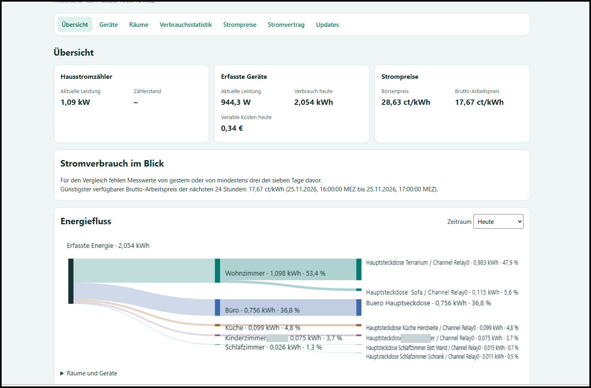
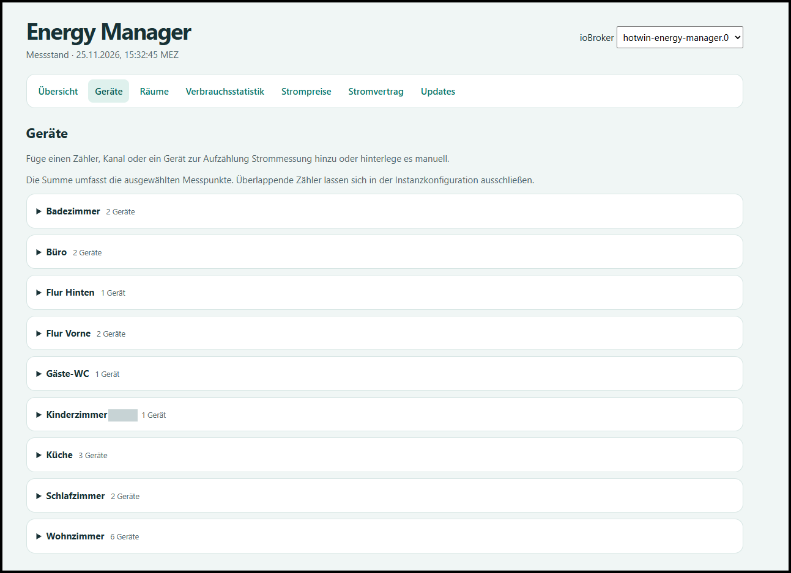
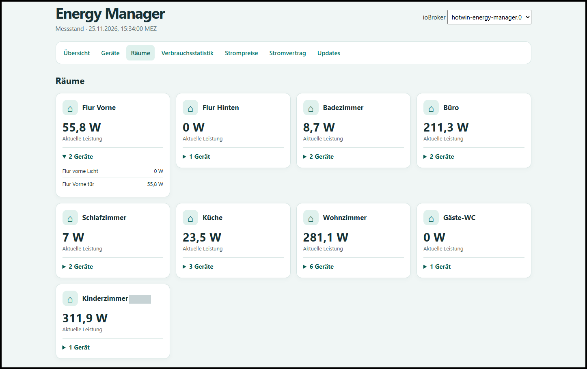
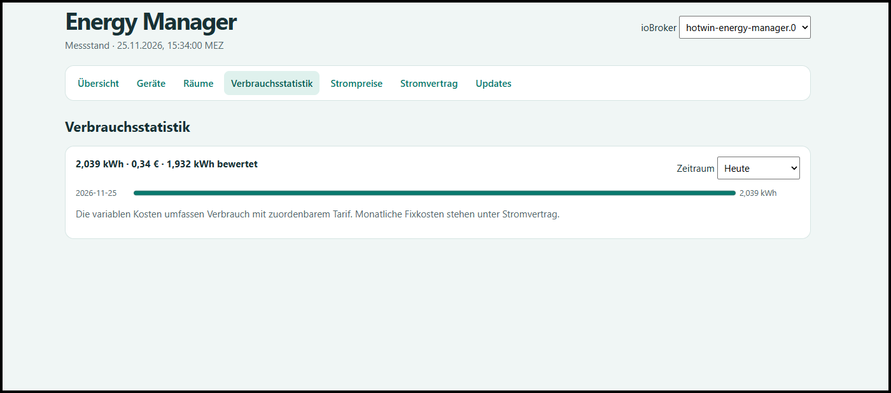
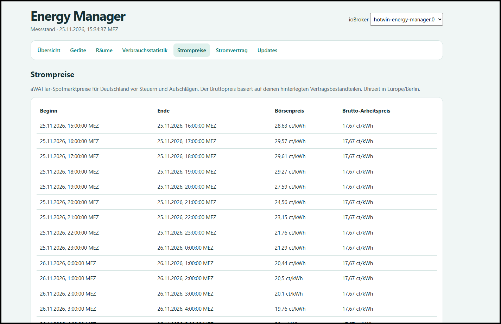
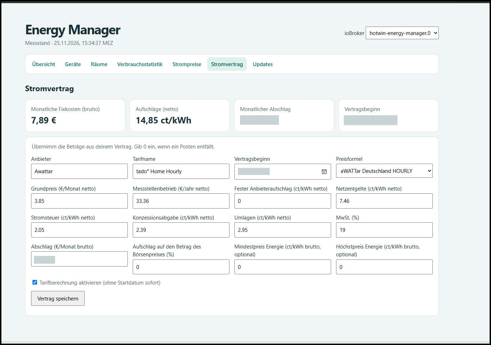
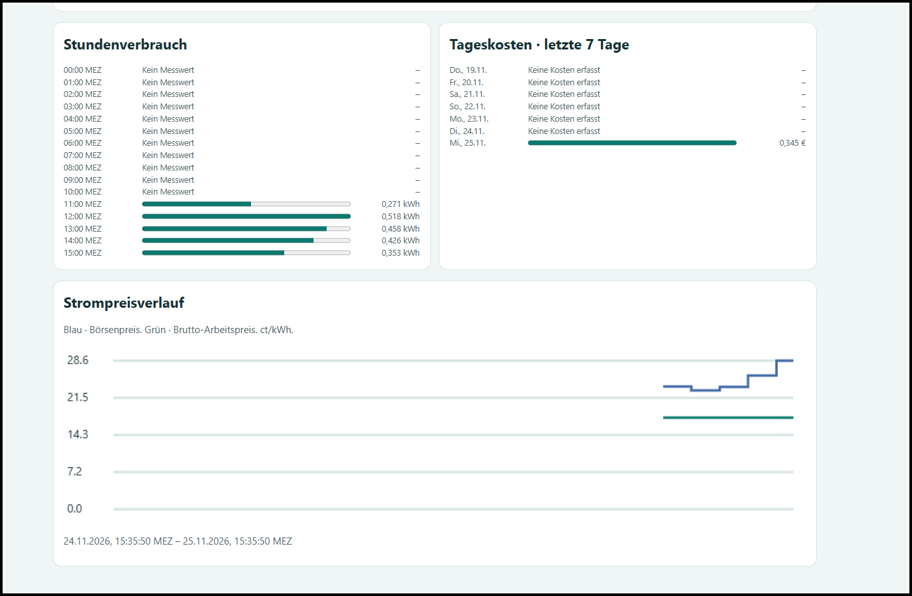

# Energy Manager einrichten

Der Energy Manager erfasst Stromverbrauch, Leistung und variable Stromkosten lokal in ioBroker.

Voraussetzungen: Node.js ab 22, Admin ab 7.6.20, js-controller ab 6.0.11 sowie vorhandene Messdatenpunkte. Installiere den Adapter über **Adapter** im ioBroker Admin, sobald er im eingestellten Repository verfügbar ist. Der Adapter ist noch nicht in ioBroker Latest oder Stable aufgenommen.

## Funktionen

- Herstellerübergreifende Geräteerkennung über Strommessung, manuelle Zuordnung und optionale Shelly-Erkennung.
- Live-Leistung, Verbrauch, Raumkarten mit aufklappbaren Geräten und bearbeitbare Gerätenamen.
- Energieflussdiagramm, Stundenverbrauch, Tageskosten und Strompreisverlauf.
- Statistiken für sieben Tage, Monat, Quartal und Jahr.
- Bearbeitbare Vertragsdaten, Brutto-Arbeitspreis, Mehrwertsteuer, aWATTar HOURLY-Aufschlag und optionale Preisgrenzen.
- Responsives deutsch- und englischsprachiges Dashboard im Admin und optional über den Web-Adapter.

## Screenshots – 0.3.0-beta.12

Aufnahmen einer laufenden Beta-12-Instanz. Persönliche Angaben wurden teilweise anonymisiert; die angezeigten Tarifwerte sind noch Gegenstand der Fehlerprüfung (#23).

### Übersicht und Energieverteilung nach Räumen und Geräten



### Geräte nach Räumen gruppiert



### Raumkarten mit aktueller Leistung



### Verbrauchsstatistik



### Strompreisintervalle



### Stromvertragskonfiguration



### Stundenverbrauch, Tageskosten und Strompreisverlauf



## Einrichtung

Die Adapterkennung lautet jetzt `hotwin-energy-manager`. ioBroker legt dafür eine neue Instanz an. Bisherige Einstellungen und Verbrauchsdaten bleiben bei der alten Instanz.

1. Lege im ioBroker Admin eine Funktionsaufzählung namens **Strommessung** oder **Energy measurement** an.
2. Füge die numerischen Messdatenpunkte, deren Kanal oder das Gerät hinzu. **W** oder **kW** liefern die Live-Leistung, ein fortlaufender Zähler in **Wh** oder **kWh** liefert den Verbrauch. Lege Leistung und Energie nach Möglichkeit in denselben Kanal.
3. Weise Geräte über die ioBroker-Raumaufzählungen zu. Manuell hinterlegte Raumnamen haben Vorrang. Die automatische Shelly-Erkennung lässt sich in der Instanzkonfiguration abschalten.
4. Aktiviere die Instanz und öffne Energy Manager im Admin-Menü. Optional erreichst du das Dashboard über den Web-Adapter unter `/hotwin-energy-manager/index.html` mit integriertem Socket und aktivierten WebSockets.
5. Hinterlege die Nettobestandteile deines Vertrags und die Mehrwertsteuer in der Instanzkonfiguration. Aktiviere den berechneten Bruttotarif, sobald du die Bestandteile geprüft hast.

Der Adapter speichert Verbrauch anhand fortlaufender Zählerstände. Rücksetzungen, längere Messlücken und Intervalle über Mitternacht setzen den Ausgangswert neu. Die Aufzeichnung beginnt mit der Installation. Geräte mit reiner Leistungsmessung tragen zur Live-Leistung bei. Bei einem Preisintervall- oder Tarifwechsel zwischen Messungen wird der Verbrauch erfasst und bleibt ohne Kostenbewertung. Die Statistik zeigt erfasste variable Kosten und bewertete Kilowattstunden. Monatliche Fixkosten und Abschläge stehen unter Stromvertrag. Vergleiche den verwendeten aWATTar-Spotmarktpreis für Deutschland mit dem Preisindex deines Anbieters.

Schließe überlappende Haupt- oder Unterzähler in den manuellen Energiequellen aus, damit die Summen sie nur einmal enthalten. Geräte mit uneindeutiger Datenpunktstruktur lassen sich ebenfalls manuell zuordnen. Der Adapter behält bis zu 400 Tageswerte in ioBroker.

### Daten aus einer alten Instanz übernehmen

Seit Beta 9 kopiert der optionale Konsolenbefehl Einstellungen, Tarifdaten, Gerätealiase und den gespeicherten Verbrauch aus einer installierten `energy-manager`-Instanz in eine installierte `hotwin-energy-manager`-Instanz. Vorhandene Tages-, Stunden-, Geräte- und Preisverläufe werden übernommen. Die neue Instanz ermittelt den Zähler-Ausgangswert erneut.

1. Deaktiviere beide Instanzen im ioBroker Admin und warte, bis sie gestoppt sind. Lass die alte Instanz installiert. Verwende das ioBroker-Hostkonto und führe den Befehl aus dem Installationsverzeichnis aus (meist `/opt/iobroker`). Führe die Migration in einem Multihost-System nur auf dem Host der Zielinstanz aus. Lass beide Instanzen deaktiviert und bearbeite ihre Einstellungen während der Übernahme nicht.
2. Starte den Probelauf. Ersetze die jeweilige `0` durch die tatsächliche Instanznummer. Die Ausgabe zeigt die betroffenen Einstellungen, den Verlauf beider Instanzen und bestehende Zieldaten, die ersetzt würden.

   ```bash
   node node_modules/iobroker.hotwin-energy-manager/lib/migrate-legacy.js --from 0 --to 0
   ```

3. Erstelle mit `iobroker backup` ein ioBroker-Backup. Führe dann den folgenden Befehl aus. Wähle für die Sicherungsdatei einen neuen Namen in einem privaten Verzeichnis. Der Befehl sichert beide Instanzen in einer privaten Datei, bevor er das Ziel ändert.

   ```bash
   node node_modules/iobroker.hotwin-energy-manager/lib/migrate-legacy.js --from 0 --to 0 --apply --backup ./energy-migration-backup.json
   ```

   Wenn der Probelauf einen Konflikt meldet, ergänze `--overwrite` nur dann, wenn du die aufgeführten Zieleinstellungen und gegebenenfalls den gesamten Zielverlauf ersetzen möchtest. Verläufe werden als Ganzes kopiert. Der Befehl ändert weder die alte Instanz noch ihre Daten.

4. Aktiviere nach erfolgreicher Übernahme die neue Instanz und überprüfe Vertrag, Gerätealiase und Statistik im Admin. Bewahre die alte Instanz und beide Sicherungen bis zum Abschluss der Prüfung auf.

Meldet der Befehl einen Fehler nach einem Schreibversuch, lass beide Instanzen deaktiviert und wiederhole den Probelauf. Bereits übernommene Einstellungen und identische Verläufe werden beim nächsten Lauf übersprungen. Bewahre die ursprüngliche Sicherung auf und verwende für jeden Schreibversuch einen neuen Dateinamen. Mit dem ioBroker-Backup kannst du den vorherigen Stand der Installation wiederherstellen. Wenn nach einem Prozessabbruch `iobroker-data/.hotwin-energy-manager-migration.lock` zurückbleibt, entferne die Datei erst, wenn du geprüft hast, dass keine Migration mehr läuft.
