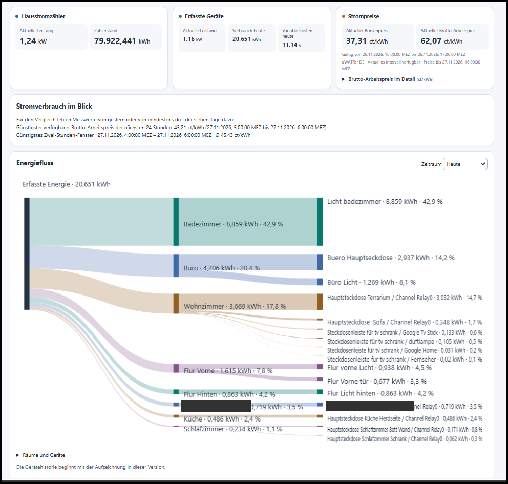
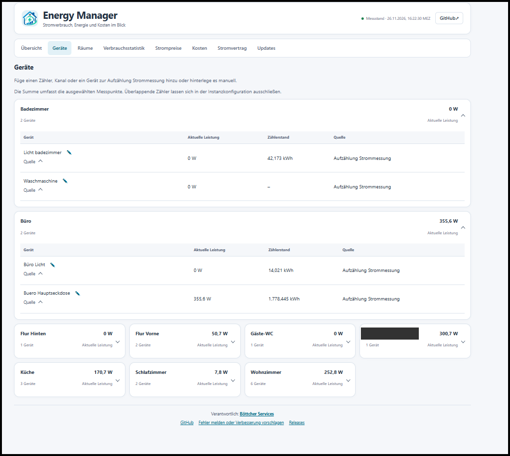
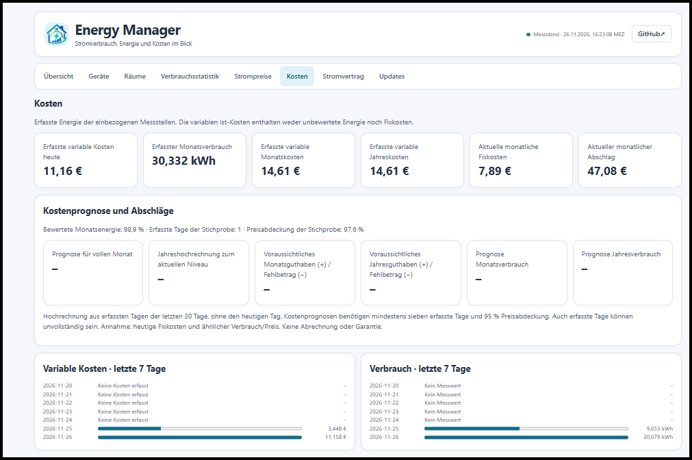
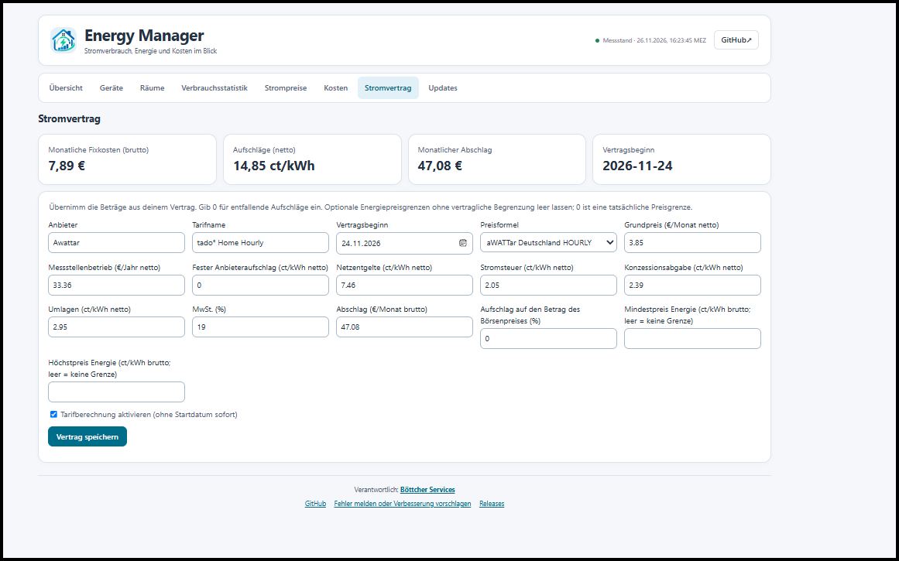
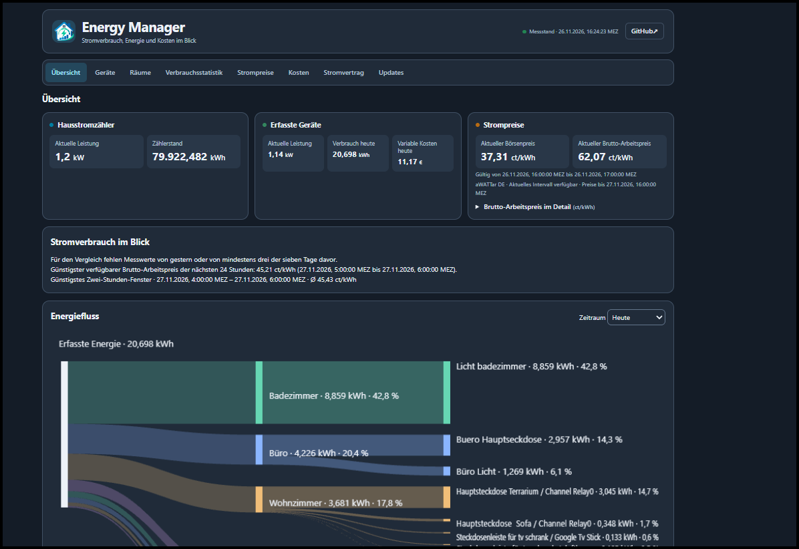

# ioBroker Energy Manager

**Verantwortlich: [Böttcher Services](http://boettcher-services.duckdns.org/)** · [hotwin@gmx.net](mailto:hotwin@gmx.net)

Der Energy Manager erfasst Stromverbrauch, Leistung und variable Stromkosten lokal in ioBroker. Er verbindet Messdaten verschiedener Hersteller mit Raumübersichten, Kostenanalyse und auswählbaren Börsenpreisquellen.

[English](../../README.md) · [Ausführliche Einrichtung](SETUP.md) · [Zweisprachiger Versionsverlauf](../RELEASE-HISTORY.md) · [npm](https://www.npmjs.com/package/iobroker.hotwin-energy-manager)

## Funktionen

### Stromverbrauch und Geräte
- Herstellerübergreifende Erkennung über Funktionsaufzählungen, manuelle Zuordnung und optionale Shelly-Erkennung.
- Live-Leistung, fortlaufende Zählerstände, separat zugeordneter Hauptzähler, Räume und frei änderbare Gerätenamen.
- Aufklappbare Gerätekarten, Energieflussdiagramm, stündliche und tägliche Verbrauchssäulen sowie bis zu 400 Tageswerte.
- Getrennte Statusanzeigen für lokale Datenerfassung und Börsenpreisquelle; Hauptzählerdiagnose und optionale nicht zugeordnete Leistung.

### Historie und Datenspeicherung
- Numerische Verlaufsdatenpunkte für Räume und Geräte; wählbare History-, InfluxDB- oder SQL-Instanz für Tageswerte und laufende Messwerte.
- Vergleiche laufender und vorheriger Wochen, Monate und Jahre, Monatsarchiv sowie Gerätevergleich anhand erfasster Messtage.

### Kosten und Verbrauchsanalyse
- Erfasste variable Kosten und Preisabdeckung auch je Gerät, Monats- und Jahreshochrechnung, Abschlagsvergleich, Fixkosten, Budgetwarnung und Sieben-Tage-Übersicht.
- Vergleich mit alternativem Arbeitspreis, Geräte-Rangliste, Tagesdaten als CSV und einfacher Amortisationsrechner mit selbst eingegebener jährlicher Nettoersparnis.

### Strompreise und Tarife
- aWATTar Deutschland/Österreich, Energy-Charts-Gebotszonen und eigene ioBroker-JSON-Preisquelle.
- Börsenpreis, Brutto-Arbeitspreis, Gültigkeitszeitraum, Tarifaufschlüsselung und günstigstes verfügbares zusammenhängendes Zwei-Stunden-Fenster.
- Vertragsbestandteile, Mehrwertsteuer, prozentualer Aufschlag, optionale Preisgrenzen, Grundpreis und Abschlag.

### PV, Speicher und Visualisierung
- Optionale Live-Anzeige für PV-Erzeugung, Netzeinspeisung und Batterieladestand; keine Anlagensteuerung.
- Responsives Dashboard in Deutsch und Englisch, automatischer Hell-/Dunkelmodus und einheitliche Konfigurationsreiter einschließlich Speicher-Einstellungen.
- Lesbare Datenpunkte für Skripte und Blockly, importierbare VIS-Classic- und VIS-2-Widgets sowie optionale Übernahme einer alten Instanz mit Probelauf und Sicherung.

## Screenshots

Echte Aufnahmen der laufenden Entwicklungsversion **0.6.0-beta.8** vom 26. November 2026. Persönliche Bezeichnungen wurden abgedeckt. Prognosen fehlen, solange nicht genügend Messdaten vorliegen.

### Übersicht und Energiefluss

### Geräteübersicht

### Raumübersicht

### Verbrauchsstatistik

### Kostenmanager und Prognosen

### Strompreise

### Stromvertrag

### Dunkelmodus

### Updates

[Vollständige Galerie inklusive Prognosedetails](../screenshots/0.6.0-beta.8/README.md)

## Installation

Voraussetzungen: Node.js ab 22, Admin ab 7.6.20, js-controller ab 6.0.11 sowie vorhandene Messdatenpunkte.

Sobald der Adapter im konfigurierten ioBroker-Repository verfügbar ist, installiere ihn im Admin unter **Adapter**. Die veröffentlichte Beta wartet auf die Aufnahme in das offizielle Latest- oder Stable-Repository.

## Einrichtung

Die Adapterkennung lautet jetzt `hotwin-energy-manager`. ioBroker legt dafür eine neue Instanz an. Bisherige Einstellungen und Verbrauchsdaten bleiben bei der alten Instanz. Der Adapter ermöglicht eine [optionale Übernahme](SETUP.md#daten-aus-einer-alten-instanz-übernehmen).

1. Lege im ioBroker Admin eine Funktionsaufzählung namens **Strommessung** oder **Energy measurement** an.
2. Füge die numerischen Messdatenpunkte, deren Kanal oder das Gerät hinzu. **W** oder **kW** liefern die Live-Leistung, ein fortlaufender Zähler in **Wh** oder **kWh** liefert den Verbrauch. Lege Leistung und Energie nach Möglichkeit in denselben Kanal.
3. Weise Geräte über die ioBroker-Raumaufzählungen zu. Manuell hinterlegte Raumnamen haben Vorrang. Die automatische Shelly-Erkennung lässt sich in der Instanzkonfiguration abschalten.
4. Aktiviere die Instanz und öffne Energy Manager im Admin-Menü. Optional erreichst du das Dashboard über den Web-Adapter unter `/hotwin-energy-manager/index.html` mit integriertem Socket und aktivierten WebSockets.
5. Hinterlege die Nettobestandteile deines Vertrags und die Mehrwertsteuer in der Instanzkonfiguration. Aktiviere den berechneten Bruttotarif, sobald du die Bestandteile geprüft hast.

Der Adapter speichert Verbrauch anhand fortlaufender Zählerstände. Rücksetzungen, längere Messlücken und Intervalle über Mitternacht setzen den Ausgangswert neu. Die Aufzeichnung beginnt mit der Installation. Geräte mit reiner Leistungsmessung tragen zur Live-Leistung bei. Bei einem Preisintervall- oder Tarifwechsel zwischen Messungen wird der Verbrauch erfasst und bleibt ohne Kostenbewertung. Die Statistik zeigt erfasste variable Kosten und bewertete Kilowattstunden. Monatliche Fixkosten und Abschläge stehen unter Stromvertrag. Vergleiche den verwendeten aWATTar-Spotmarktpreis für Deutschland mit dem Preisindex deines Anbieters.

Schließe überlappende Haupt- oder Unterzähler in den manuellen Energiequellen aus, damit die Summen sie nur einmal enthalten. Geräte mit uneindeutiger Datenpunktstruktur lassen sich ebenfalls manuell zuordnen. Der Adapter behält bis zu 400 Tageswerte in ioBroker.

## Weiterentwicklung

Die automatischen Tests und der npm-Upload der Beta 8 waren erfolgreich. Der Adapter soll langfristig gepflegt und anhand von Rückmeldungen weiterentwickelt werden.

- [Datenmigration](https://github.com/hotwin/ioBroker.hotwin-energy-manager/issues/11): optional verfügbar, alte Instanz bitte behalten und Daten sichern.
- [Aufnahme in ioBroker Latest](https://github.com/hotwin/ioBroker.hotwin-energy-manager/issues/10): in Vorbereitung.
- [Main und Developer Portal](https://github.com/hotwin/ioBroker.hotwin-energy-manager/pull/12): Zusammenführung noch nicht abgeschlossen.

Fehler und Vorschläge: [GitHub Issues](https://github.com/hotwin/ioBroker.hotwin-energy-manager/issues) oder [ioBroker-Forum](https://forum.iobroker.net/topic/85923/test-adapter-energy-manager/4).

## VIS Classic und VIS 2

Fertige Kacheln: [VIS Classic](../vis/energy-manager-vis-classic.json) · [VIS 2](../vis/energy-manager-vis-2.json). Im passenden Editor den Widget-Import öffnen und den Inhalt der JSON-Datei einfügen. Die Kacheln nutzen die eingebauten Basiswidgets und sind auf `hotwin-energy-manager.0` eingestellt. Bei abweichender Instanznummer die IDs vor dem Import anpassen.

Wähle im jeweiligen VIS-Editor ein Basis-Wertwidget und setze dessen Objekt-ID beispielsweise auf `hotwin-energy-manager.0.todayEnergy`. Ersetze `.0` bei Bedarf durch deine Instanznummer. Die folgenden numerischen Datenpunkte sind schreibgeschützt und ohne Messwert leer. Die Einheit kannst du im Widget ergänzen.

| Datenpunkt | Wert |
| --- | --- |
| `totalPower` | Leistung der erfassten Geräte (W) |
| `todayEnergy` | Verbrauch der erfassten Geräte heute (kWh) |
| `todayCost` | Bewertete variable Kosten heute (EUR) |
| `currentMarketPrice` | Aktueller Börsenpreis (ct/kWh) |
| `currentGrossPrice` | Aktueller Brutto-Arbeitspreis (ct/kWh) |
| `houseMeterEnergy` | Gesamtstand des Hauptzählers (kWh) |

Für reine Textanzeigen mit bereits enthaltener Einheit stehen `displayPower`, `displayToday`, `displayMarket`, `displayTariff` und `displayCost` bereit.

Versionsverlauf: [Englischer Changelog](../../README.md#changelog).
