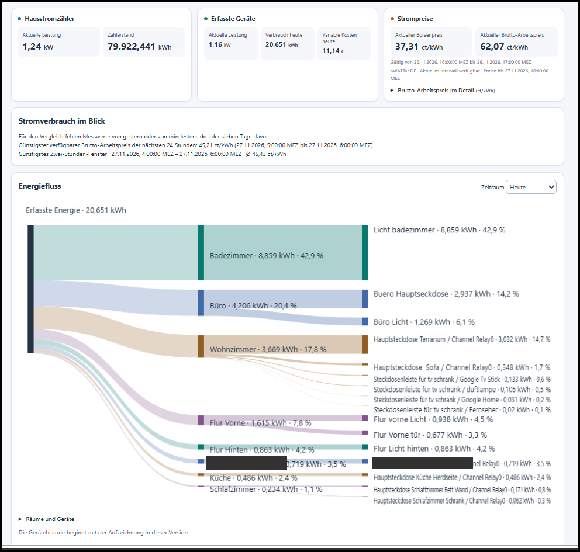
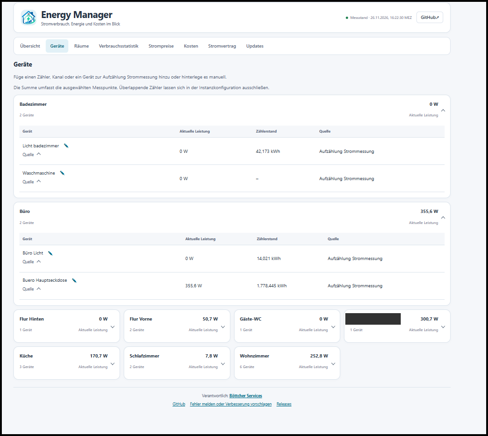
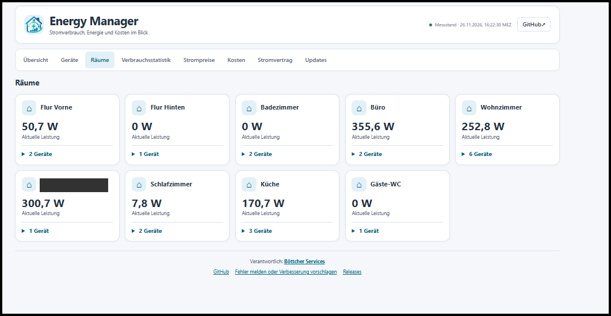
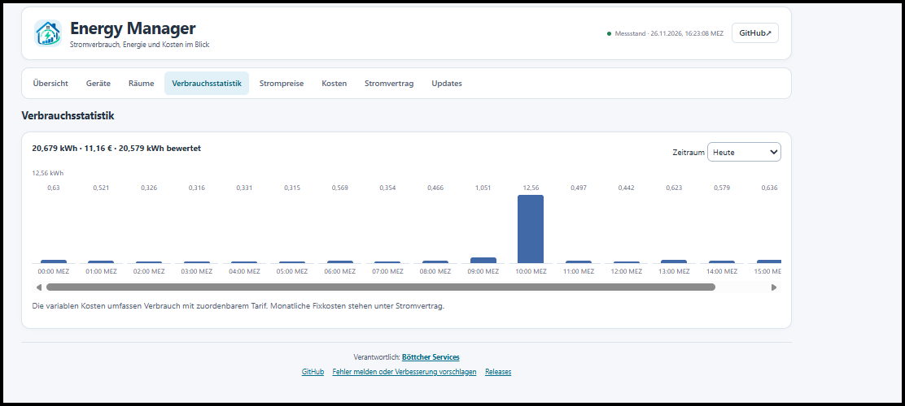
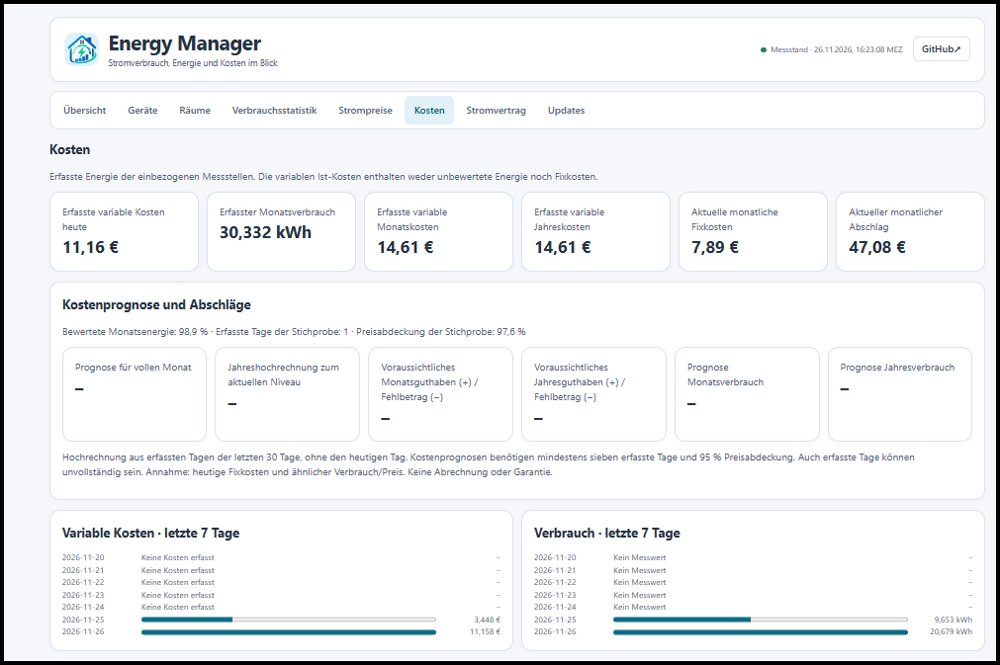
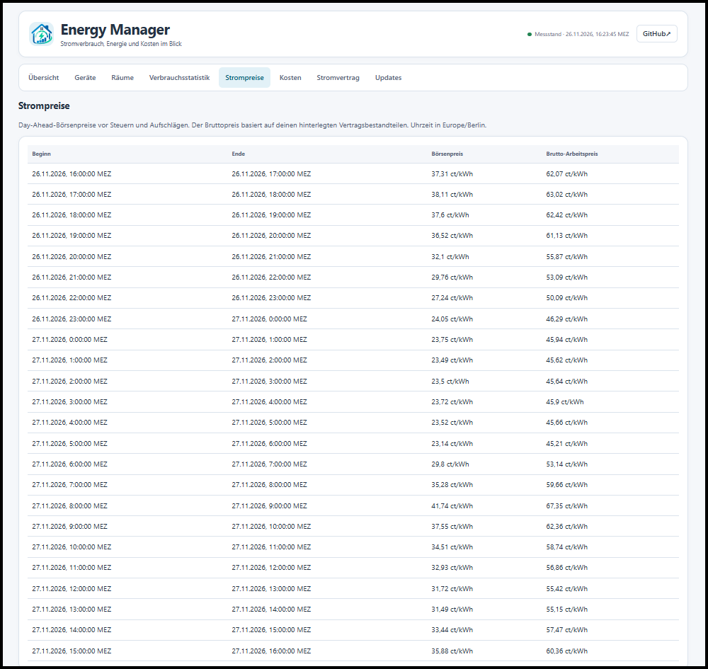
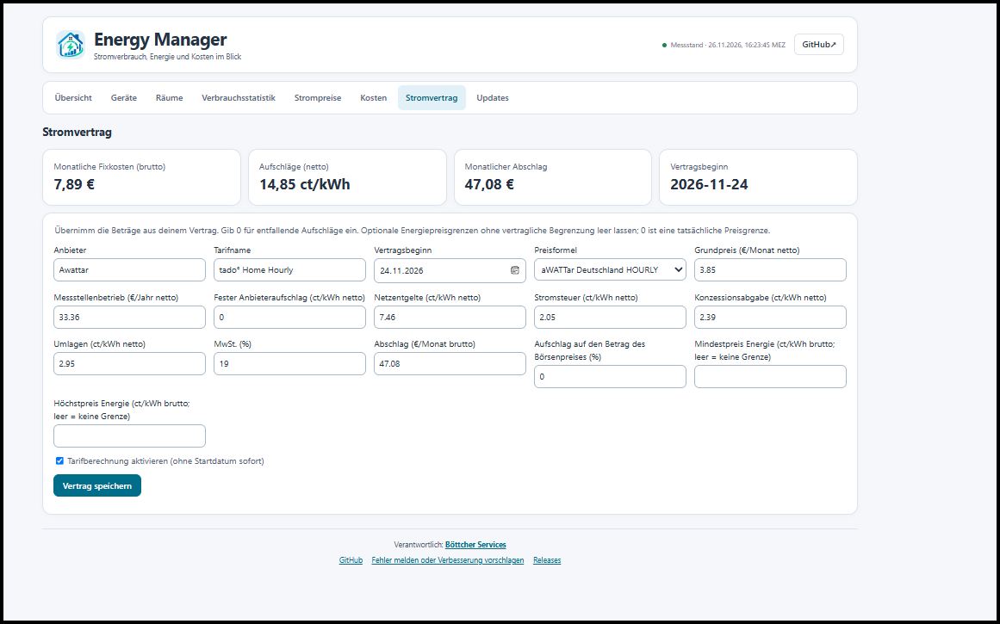
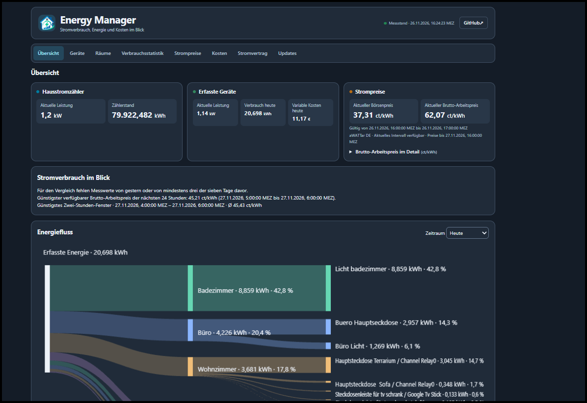
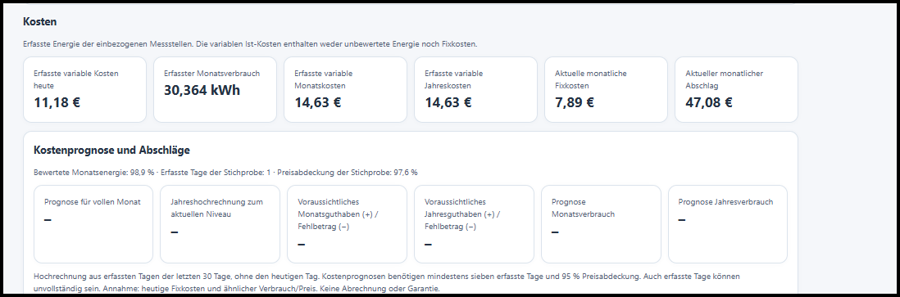
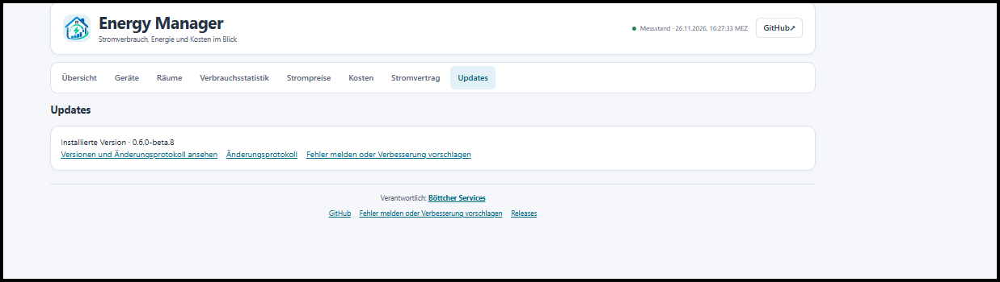

# Dashboard screenshots — 0.6.0-beta.8

Genuine screenshots from a running development instance on 26 November 2026. Personal labels are redacted. These images show beta.8, not the final 0.6.0 release. Forecasts are empty until sufficient recorded data is available.

## Overview and energy flow

## Devices grouped by room

## Room overview

## Consumption statistics

## Cost manager and forecasts

## Electricity price intervals

## Contract and tariff settings

## Dark mode

## Forecast detail

## Version and updates

